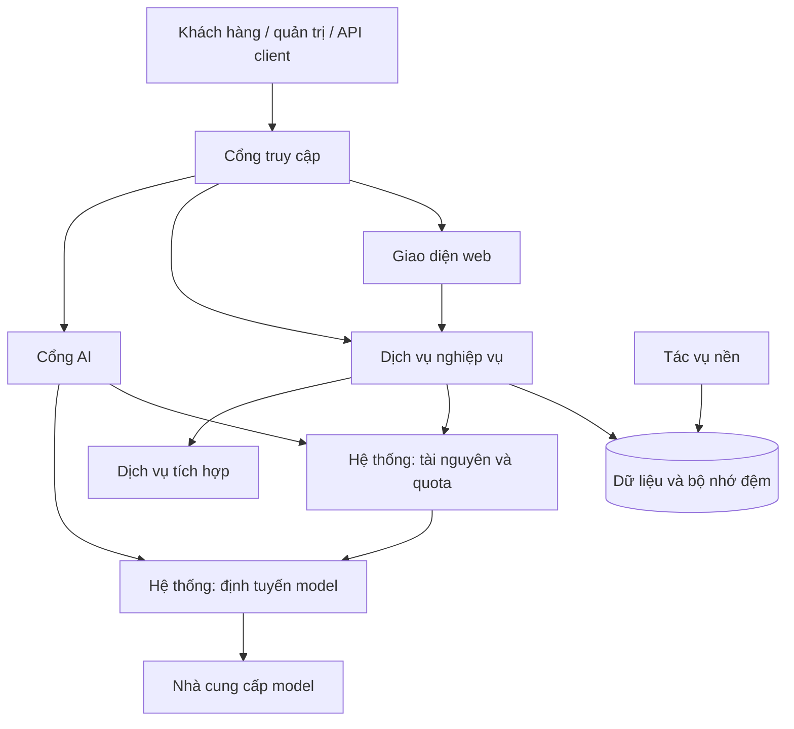

# SHOP AI PRO

**Nền tảng cung cấp dịch vụ AI, quản lý API key, credit và điều phối model.**

Storefront · API Gateway · Quản lý API key, credit & usage

[**Website ↗**](https://shopaipro.tech) · [Giới thiệu](#giới-thiệu) · [Tính năng](#tính-năng) · [Kiến trúc](#kiến-trúc) · [Chạy local](#chạy-local) · [API](#api-và-xác-thực) · [Triển khai](#triển-khai-và-vận-hành) · [Tài liệu](#tài-liệu)

---

## Giới thiệu

**SHOP AI PRO** là nền tảng kết hợp storefront, tài khoản khách hàng, đơn hàng và quyền truy cập model AI. Khách hàng có thể xem sản phẩm, theo dõi đơn hàng, quản lý API key, credit và mức sử dụng; quản trị viên quản lý nội dung, sản phẩm, thanh toán và hỗ trợ.

Hệ thống được tổ chức thành **giao diện web**, **các dịch vụ nghiệp vụ**, **cổng truy cập AI** và **các thành phần tích hợp**. Mục tiêu là cung cấp trải nghiệm sử dụng thống nhất, quản lý quyền truy cập rõ ràng và theo dõi tài nguyên theo tài khoản.

> **Phạm vi README:** giới thiệu sản phẩm và kiến trúc tổng quát. Repository chỉ chứa tài liệu công khai và logo thương hiệu; không kèm source code hoặc cấu hình vận hành.

## Tính năng

Các nhóm chức năng có mã nguồn trong dự án; khả năng sử dụng thực tế phụ thuộc cấu hình, feature flag, quyền tài khoản và dịch vụ tích hợp.

| Nhóm | Nội dung |
| --- | --- |
| **Storefront** | Danh mục sản phẩm, phân loại, thông tin gói dịch vụ, giá và nội dung công khai |
| **Tài khoản** | Đăng ký/đăng nhập, hồ sơ, xác thực Google/Firebase, phiên đăng nhập và xác thực hai bước theo cấu hình |
| **Thương mại** | Đơn hàng, giỏ hàng, coupon, ví, top-up, thanh toán PayOS/PayPal và đối soát |
| **API key & quyền sử dụng** | Cấp và quản lý key, entitlement, credit theo nhà cung cấp, usage và quota |
| **API Token** | Client key/secret key, phân quyền scope, kiểm tra trạng thái, hạn dùng và giới hạn sử dụng |
| **Model gateway** | Endpoint tương thích các giao thức model, chuyển tiếp request, streaming và điều phối tuyến |
| **Gói Limit** | Luồng tồn kho, lease, cấp quyền và đồng bộ tài khoản cho sản phẩm Limit |
| **AI Chat & media** | Giao diện trò chuyện, lịch sử và luồng media theo quyền/tích hợp được bật |
| **Hỗ trợ & tương tác** | Liên hệ, chat hỗ trợ, thông báo, hoạt động người dùng và nội dung hướng dẫn |
| **Quản trị** | Sản phẩm, nội dung, khách hàng, đơn hàng, thanh toán, key và tác vụ vận hành |
| **Client tooling** | Script cài đặt/cấu hình client AI, đồng bộ model và ShopAIPro Launcher |
| **Tác vụ nền** | Xử lý outbox, đồng bộ, khôi phục nghiệp vụ và gửi thông báo theo worker được chọn |

## Kiến trúc

Sơ đồ mô tả quan hệ ở mức tổng quát. Luồng xử lý cụ thể phụ thuộc sản phẩm, model, quyền tài khoản và cấu hình của từng môi trường.

### Các thành phần chính

| Thành phần | Vai trò |
| --- | --- |
| Giao diện | Cửa hàng, tài khoản, quản trị và trò chuyện AI |
| Danh tính | Đăng nhập, xác thực và quản lý quyền |
| Danh mục & nội dung | Sản phẩm, hướng dẫn, FAQ và chính sách |
| Thương mại | Đơn hàng, ví, thanh toán và đối soát |
| Hệ thống tài nguyên | API key, credit, quota và quyền sử dụng |
| Hệ thống định tuyến | Điều phối yêu cầu tới model và tuyến xử lý phù hợp |
| Hỗ trợ | Liên hệ, thông báo và tương tác người dùng |
| Tác vụ nền | Đồng bộ, xử lý hàng đợi và công việc định kỳ |

## Công nghệ

| Thành phần | Công nghệ tiêu biểu |
| --- | --- |
| Backend | Go, Fiber |
| Frontend | Next.js, React, TypeScript, Tailwind CSS |
| Dữ liệu | PostgreSQL, Redis |
| Triển khai | Container, reverse proxy và nền tảng đám mây |
| Tích hợp | Xác thực, thanh toán, lưu trữ và dịch vụ AI |

Kiến trúc và cấu hình có thể được điều chỉnh theo nhu cầu của từng môi trường.

## Chạy local

Đây là mô tả quy trình phát triển ở mức tổng quát; source code và cấu hình triển khai không được cung cấp trong repository giới thiệu.

1. Chuẩn bị công cụ và môi trường phát triển phù hợp.
2. Cài dependency cho giao diện và dịch vụ nghiệp vụ.
3. Thiết lập cơ sở dữ liệu, bộ nhớ đệm và tích hợp bằng tài khoản phát triển riêng.
4. Khởi động các thành phần cần sử dụng và kiểm tra kết nối.
5. Kiểm thử chức năng với dữ liệu thử nghiệm trước khi triển khai.

Thông số kết nối, cổng dịch vụ và quyền truy cập được quản lý riêng theo môi trường.

## API và xác thực

Nền tảng cung cấp giao diện API cho ứng dụng và công cụ AI. Các nhóm truy cập chính gồm:

| Nhóm | Mục đích |
| --- | --- |
| Tài khoản | Hồ sơ, đơn hàng và thông tin sử dụng theo quyền |
| API Token | Tự động hóa với phạm vi quyền được cấp |
| Model API | Gửi yêu cầu tới model bằng key và quyền sử dụng tương ứng |

Mỗi yêu cầu được kiểm tra thông tin xác thực, trạng thái tài khoản, quyền truy cập và hạn mức phù hợp. API Token và model key phục vụ các mục đích khác nhau; hãy sử dụng đúng loại credential theo hướng dẫn.

Các giao thức có thể bao gồm Responses, Chat Completions hoặc Messages tùy model và sản phẩm. Hướng dẫn cấu hình client và ví dụ sử dụng được công bố tại [trang tài liệu chính thức](https://shopaipro.tech/docs).

## Kiểm thử và kiểm chứng

Các nhóm kiểm tra gồm logic nghiệp vụ, dữ liệu đầu vào, xác thực, quyền truy cập, giao diện và khả năng kết nối dịch vụ AI. Các luồng liên quan đến credit, quota và thanh toán cần được đối chiếu tính nhất quán của trạng thái giao dịch.

Kết quả kiểm chứng phụ thuộc phiên bản và môi trường thực tế. Repository giới thiệu không công bố cấu hình kiểm thử hoặc báo cáo vận hành nội bộ.

## Triển khai và vận hành

Các thành phần được triển khai độc lập và kết nối qua cổng truy cập thống nhất. Cấu hình được lựa chọn theo quy mô, tải sử dụng và yêu cầu của môi trường.

Quy trình vận hành gồm kiểm tra cấu hình, triển khai phiên bản, theo dõi trạng thái, sao lưu dữ liệu và phục hồi khi cần. Thông số hạ tầng, hướng dẫn quản trị và tài liệu vận hành chi tiết được quản lý riêng.

## Bảo mật và quản lý cấu hình

- Phân quyền theo vai trò và mục đích sử dụng.
- Quản lý riêng thông tin xác thực và cấu hình nhạy cảm.
- Kiểm tra dữ liệu đầu vào, hạn mức và trạng thái giao dịch.
- Bảo vệ kết nối giữa các thành phần và dịch vụ tích hợp.
- Theo dõi, sao lưu và kiểm tra khả năng phục hồi theo môi trường.

Không công khai API key, dữ liệu khách hàng hoặc cấu hình quản trị trong repository giới thiệu.

## Phạm vi công khai

Repository chỉ bao gồm **README giới thiệu** và **logo từ website chính thức**. Mã nguồn, cấu trúc thư mục phát triển và tài liệu vận hành không nằm trong phạm vi công khai.

## Tài liệu

Tài liệu dành cho người sử dụng được cung cấp tại [shopaipro.tech/docs](https://shopaipro.tech/docs), gồm hướng dẫn API, cấu hình công cụ và thông tin sử dụng dịch vụ.

## Liên kết chính thức

| Kênh | Đường dẫn |
| --- | --- |
| Website | [shopaipro.tech](https://shopaipro.tech) |
| Tài liệu sử dụng | [Hướng dẫn API và công cụ AI](https://shopaipro.tech/docs) |
| Danh sách model | [Mô hình AI](https://shopaipro.tech/models) |
| Bảng giá | [Giá dịch vụ](https://shopaipro.tech/pricing) |
| Hỗ trợ | [Câu hỏi thường gặp](https://shopaipro.tech/faq) |
| Email liên hệ | [contact@shopaipro.tech](mailto:contact@shopaipro.tech) |
| Điều khoản | [Điều khoản dịch vụ](https://shopaipro.tech/terms) |
| Quyền riêng tư | [Chính sách](https://shopaipro.tech/privacy) |

Thông tin model, giá và gói dịch vụ có thể thay đổi; xem website để có thông tin hiện hành.

## Về repository này

- **Dự án:** SHOP AI PRO.
- **Mục đích:** giới thiệu sản phẩm, chức năng và kiến trúc tổng quát.
- **Website chính thức:** [https://shopaipro.tech](https://shopaipro.tech).
- **Phạm vi:** tài liệu giới thiệu và logo; không công khai source code, secrets hoặc dữ liệu khách hàng.
- **Thông tin kỹ thuật:** mô tả chung, không công bố cấu hình triển khai chi tiết.
- **Cập nhật tài liệu:** 05/11/2026.

## Quyền sử dụng

Repository giới thiệu không cấp mới hoặc thay đổi giấy phép mã nguồn. Nếu có nhu cầu sử dụng tài liệu, thương hiệu hoặc trao đổi về dự án, hãy liên hệ qua các kênh chính thức.

---

**SHOP AI PRO** · Storefront, API access và model orchestration trên cùng một nền tảng.

[Website](https://shopaipro.tech) · [Tài liệu sử dụng](https://shopaipro.tech/docs) · [Hỗ trợ](https://shopaipro.tech/faq)

